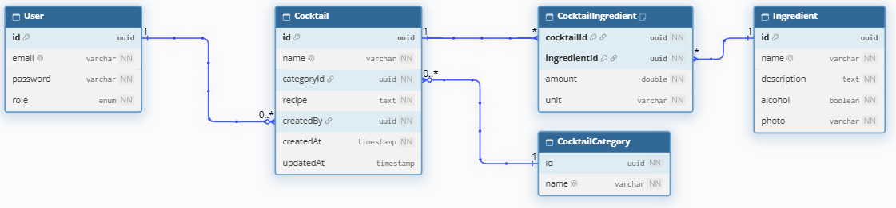

```markdown
# 🍹 Cocktail Manager API

[](https://nestjs.com/)
[](https://www.typescriptlang.org/)
[](https://www.prisma.io/)
[](https://www.postgresql.org/)
[](https://github.com/Matixy/KN-Solvro-Cocktails-API-task)

API zrealizowane w standardzie **REST API** do zarządzania koktajlami, składnikami oraz kategoriami.

## 🚀 Live Demo

Aplikacja została wdrożona na środowisko produkcyjne.

👉 **[Dokumentacja Swagger (Render)](https://kn-solvro-cocktails-api-task.onrender.com/api#/)**

> Baza danych zasilana jest z platformy [Neon.tech](https://neon.tech/). Endpointy odczytu (`GET`) są publiczne, natomiast aby przetestować operacje modyfikujące stan, użyj poniższych danych logowania w endpoint'cie `/auth/login`.

**Konta testowe (hasło dla każdego konta to: `Password123!`):**
- `admin@cocktails.local` (Rola: **ADMIN** – zarządzanie słownikami, pełen dostęp)
- `bartender@cocktails.local` (Rola: **USER** – tworzenie koktajli, edycja własnych)
- `guest@cocktails.local` (Rola: **USER** – konto do testów)

---

## 🎯 Realizacja Wymagań

✅ Pełen **CRUD** dla koktajli i składników (rozszerzony dodatkowo o kategorie).
✅ **Relacyjna baza danych** PostgreSQL obsługiwana przez prisma ORM.
✅ Generyczna **paginacja**, zaawansowane **sortowanie** i **filtrowanie**.
✅ **Walidacja danych** wejściowych przy użyciu DTO i `class-validator` (w tym parsowanie URL).
✅ **Autoryzacja JWT** z podziałem na role (USER / ADMIN).
✅ **Własność zasobów:** Tylko autor lub administrator może edytować/usunąć koktajl.
✅ **Testy Automatyczne e2e** używające biblioteki Supertest.
✅ Wygenerowana dokumentacja **Swagger OpenAPI**.

---

## 🗄 Schemat Bazy Danych

Architektura opiera się na relacyjnym modelu uwzględniającym operacje *nested writes* (zapisywanie do wielu tabel w jednej transakcji ACID, np. dodanie koktajlu z nowymi proporcjami składników).


*(Jeśli obraz się nie ładuje, plik schematu znajduje się w folderze `docs/db_schema.png`)*

---

## 🔐 Architektura Uprawnień i RBAC (Role-Based Access Control)

System wdraża zasady bezpieczeństwa oparte na rolach i tożsamości. Logika dostępów do poszczególnych tabel prezentuje się następująco:

### 1. Odczyt Danych
Wszystkie endpointy listujące (`findAll`) oraz pobierające szczegóły (`findOne`) dla koktajli, składników i kategorii są **publiczne**. Goście mogą swobodnie przeglądać menu bez tokena JWT.

### 2. Składniki i Kategorie
Są to dane słownikowe stanowiące rdzeń aplikacji.
- **Tworzenie, edycja, usuwanie:** Zarezerwowane **dla roli `ADMIN`** (chronione przez własnego strażnika `@RolesGuard`).

### 3. Koktajle
Dane generowane przez społeczność.
- **Tworzenie:** Dostępne dla każdego zalogowanego użytkownika (rola `USER` lub `ADMIN`). Identyfikator autora zaciągany jest bezpośrednio z tokena JWT.
- **Edycja i Usuwanie:** Dostępne **tylko** dla faktycznego autora danego przepisu lub dla administratora (wymuszone na poziomie reguł logiki biznesowej).

---

## 🔍 Wyszukiwanie, Filtrowanie i Sortowanie

Endpointy listujące zostały wyposażone w system zapytań URL z transformacją typów (`class-transformer`):

*   **Sortowanie jednokolumnowe:** Zabezpieczone silnie typowanymi Enumami. Umożliwia sortowanie m.in. po nazwie, dacie utworzenia, flagach logicznych, a dla koktajli – natywne sortowanie relacyjne po **nazwie powiązanej kategorii**.
*   **Zaawansowane filtrowanie składników:** Wyszukiwanie po nazwie, filtracji bezalkoholowej oraz przedziałach czasowych.
*   **Zaawansowane filtrowanie koktajli:** Możliwość wyszukiwania koktajli po nazwie, ID kategorii, *nazwie kategorii*, przedziałach czasowych, filtrowanie bezalkoholowe- system wchodzi w tabele asocjacyjne `CocktailIngredient` i weryfikuje składniki używając instrukcji `some`/`none`.

---

## Dane Startowe

- **3 Kategorie:** Classic, Tropical, Empty.
- **5 Składników:** Vodka (z alkoholem), Rum (z alkoholem), Lime Juice, Sugar Syrup, Mint.
- **3 Użytkowników:** Z zahashowanymi w bcrypt hasłami- `Password123!` (Admin, Bartender, Guest).
- **3 Koktajle:** 
  - *Mojito* (Twórca: Admin).
  - *Daiquiri* (Twórca: Bartender).
  - *Vodka Gimlet* (Twórca: Admin).

---

## 🧪 Scenariusze Testowe (End-to-End)

Projekt posiada plik testów e2e (`test/app.e2e-spec.ts`) napisany przy użyciu biblioteki **Supertest**.

**Przetestowane scenariusze:**

**Operacje Administratora (kategorie i składniki):**
  1. 🔴 Zablokowanie standardowemu użytkownikowi (`USER`) możliwości utworzenia kategorii (oczekiwano: `403 Forbidden`).
  2. 🟢 Zezwolenie administratorowi (`ADMIN`) na utworzenie nowej kategorii (oczekiwano: `201 Created`).
  3. 🟢 Zezwolenie administratorowi (`ADMIN`) na utworzenie nowego składnika (oczekiwano: `201 Created`).

**Operacje Użytkowników (zarządzanie koktajlami):**
  4. 🔴 Zablokowanie niezalogowanemu gościowi możliwości utworzenia koktajlu (oczekiwano: `401 Unauthorized`).
  5. 🟢 Zezwolenie zalogowanemu użytkownikowi (`USER`) na utworzenie koktajlu z załączonymi relacjami składników (oczekiwano: `201 Created`).
  6. 🟢 Publiczny dostęp (dla wszystkich) do odczytu wygenerowanej listy koktajli (oczekiwano: `200 OK`).
  7. 🟢 Zezwolenie twórcy (`USER`) na zaktualizowanie **własnego** koktajlu (oczekiwano: `200 OK`).
  8. 🔴 Zablokowanie użytkownikowi (`USER`) próby nadpisania koktajlu, który został stworzony przez inną osobę / administratora (oczekiwano: `403 Forbidden`).
  9. 🟢 Zezwolenie twórcy (`USER`) na usunięcie **własnego** koktajlu (oczekiwano: `204 No Content`).

---

## 💻 Instrukcja uruchomienia lokalnego

### Wymagania wstępne
- **Node.js** (wersja 20+)
- **Docker** oraz **Docker Compose**

### 1. Pobranie repozytorium
```bash
git clone https://github.com/Matixy/KN-Solvro-Cocktails-API-task.git
cd KN-Solvro-Cocktails-API-task
```

### 2. Zmienne Środowiskowe (Env)
Wygeneruj plik konfiguracyjny (domyślne dane logowania do dockera są już w nim poprawne, potrzeba jedynie klucza JWT):
```bash
cp .env.example .env
```

### 3. Uruchomienie Bazy Danych
```bash
docker compose up -d
```

### 4. Instalacja Zależności i Bazy Danych
```bash
npm install
npx prisma migrate dev
npx prisma db seed
```

### 5. Uruchomienie Aplikacji
```bash
npm run start:dev
```
Dokumentacja Swaggera jest teraz dostępna pod adresem: **[http://localhost:3000/api](http://localhost:3000/api)**

### 6. Uruchomienie Testów Automatycznych
```bash
npm run test:e2e
```

---
```